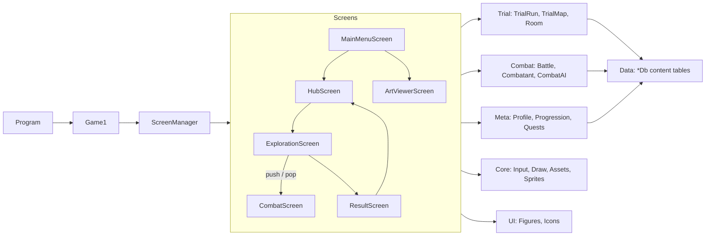
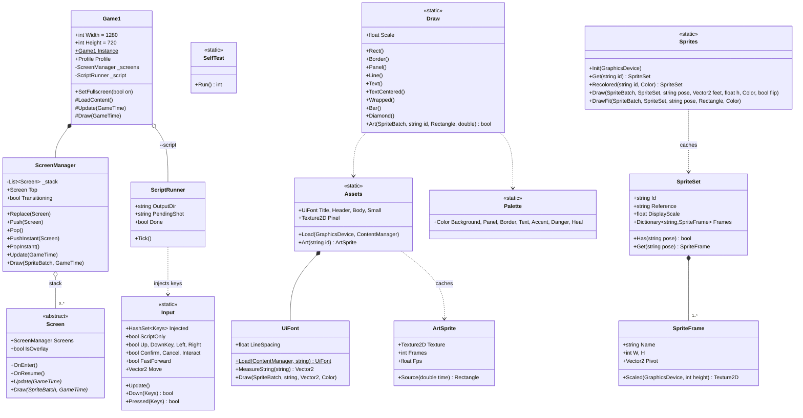
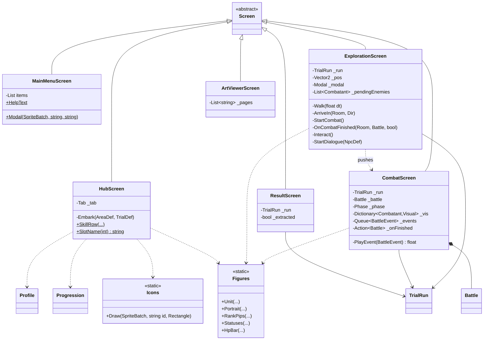
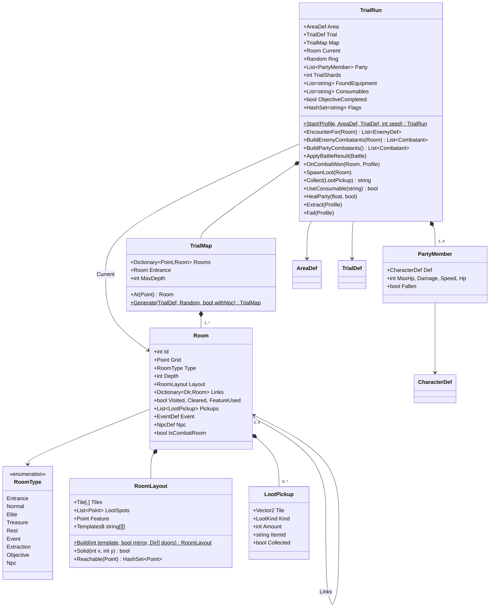
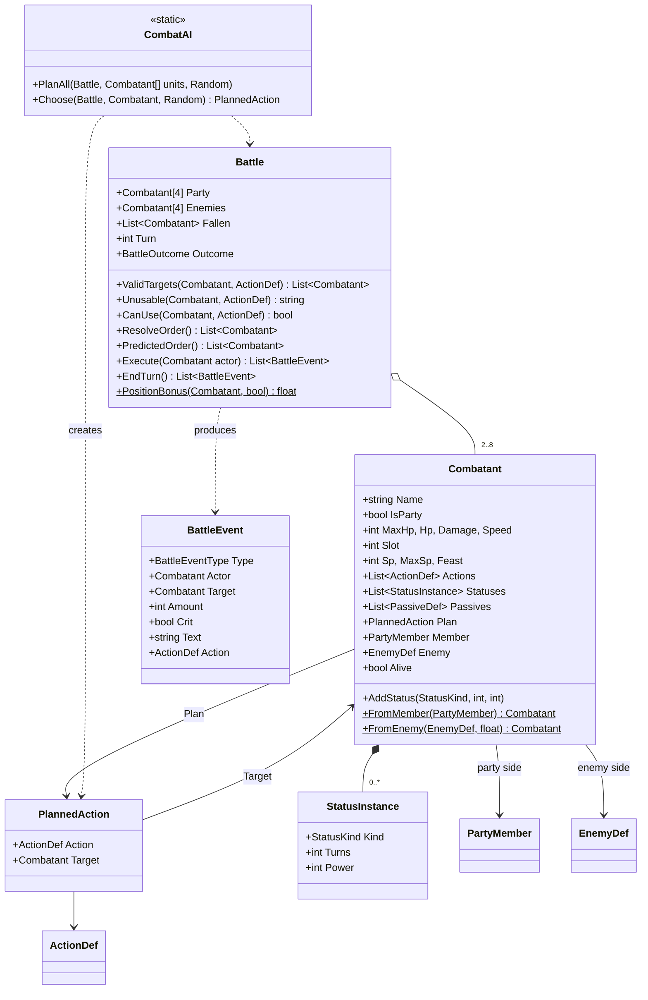
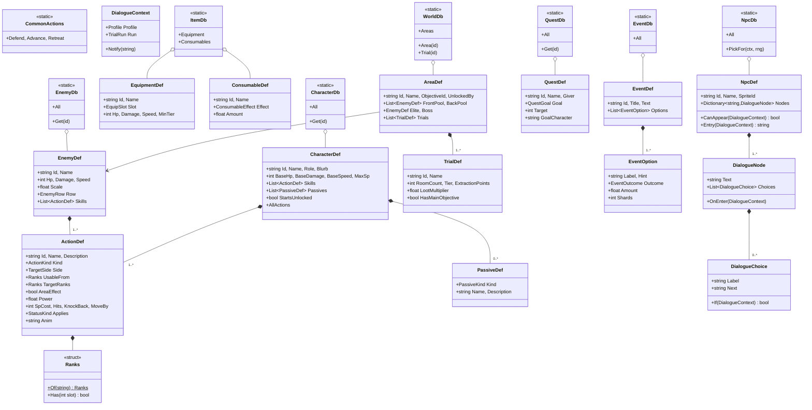
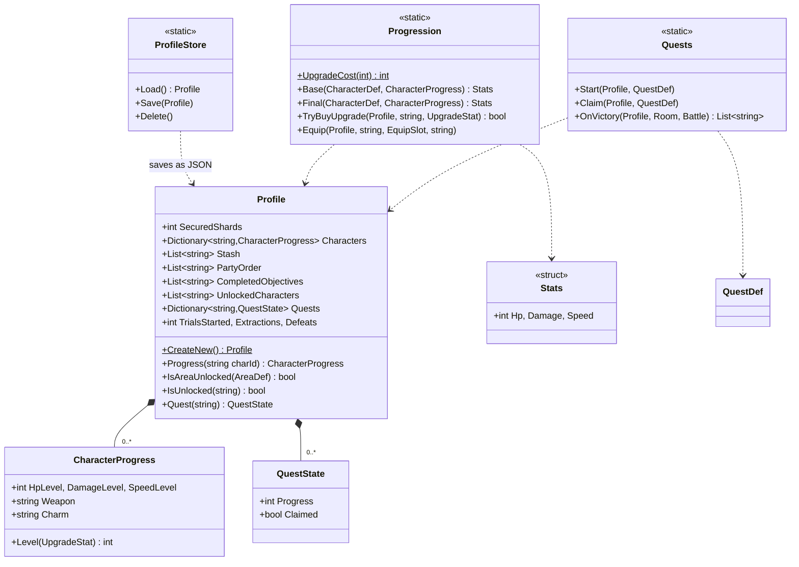

# SERAAC prototype: class diagram and code guide

Describes the build at commit **`eababdd`** on `dev` ("Increase Winter char_hunter sprite scale", 2026-09-25).
Later work (3D combat stages, combat camera, particles, mouse support, palette) is **not** included here.

MonoGame 3.8 (DesktopGL), .NET 9 (see section 8 for how MonoGame is used). The diagrams use Mermaid and render on GitHub,
in VS Code (with a Mermaid extension), and in most Markdown viewers.

---

## 1. Overview

The game is a stack of **screens**. Each screen reads input, updates its state and draws itself.
Game rules live outside the screens: **Trial** (one dive into a dungeon), **Combat** (the battle rules),
**Meta** (the save file and permanent progress) and **Data** (all content as plain C# tables).

**One run, start to finish:** Main menu → Hub (pick party, upgrade, equip, choose a Trial) →
`TrialRun.Start` generates a `TrialMap` → Exploration (walk rooms, loot, events, NPCs) → entering a combat
room pushes a `CombatScreen` over exploration → the `Battle` result is applied and the screen pops →
Extract (loot is secured into the `Profile`) or the party falls (unsecured loot is lost) → Result → Hub.

---

## 2. Core engine

---

## 3. Screens and UI helpers

---

## 4. Trial (one dive)

---

## 5. Combat (the rules, no drawing)

---

## 6. Data (content tables)

Every `*Db` is a static class holding `static readonly` definitions. Changing content means editing these
tables and rebuilding.

---

## 7. Meta (save file and permanent progress)

---

## 8. How it runs: the crucial scripts

### MonoGame, and how the game uses it

The game is built on **MonoGame 3.8 (DesktopGL)**, a C# framework that gives the game loop, graphics, input and content loading. Everything else is our own code.

- **`Game` loop:** `Game1` inherits from MonoGame's `Game`. MonoGame calls `LoadContent` once, then `Update` and `Draw` about 60 times a second. `Game1` hands both to the screen stack.
- **`GraphicsDeviceManager`:** opens the window and switches fullscreen. The game is laid out at 1280x720 and scaled to any screen with black bars.
- **`SpriteBatch`:** draws everything: sprites, rectangles, text. There are no 3D models or shaders in this build.
- **Content Pipeline (`Content.mgcb`):** compiles the fonts only (`.spritefont` to `.xnb`). Art is not in the pipeline. PNGs are read at runtime from the `Art/` folder (`Texture2D.FromFile`, and StbImageSharp for the big sprite sheets), so artists can drop files in without a build.
- **`Keyboard`:** read once per frame by `Input`.
- **MonoGame.Extended** is referenced in the project but not used by any code yet.

### The scripts that make the game work

| Script | Why it matters |
|---|---|
| `Game1.cs` | The heart of the program: runs MonoGame's loop, loads assets and the save, scales the frame to the screen. |
| `Core/Screen.cs` | The screen stack. Every part of the game (menu, hub, exploring, combat) is a screen; combat is pushed on top of exploring and popped when done. |
| `Screens/ExplorationScreen.cs` | The main gameplay: walking through rooms, loot, events, NPCs, extraction. Starts combat. |
| `Screens/CombatScreen.cs` | Lets the player choose actions and plays back the fight as animation. |
| `Combat/Battle.cs` | The combat rules: positions, speed order, damage, statuses. Returns a list of events for the combat screen to show. |
| `Trial/TrialRun.cs` + `Trial/TrialMap.cs` | One dive: generates the room map, builds the encounters, holds the loot at risk, extract or lose it. |
| `Meta/Profile.cs` | The save file: what the player keeps between dives (shards, upgrades, gear, unlocks). |
| `Data/*.cs` | All the content (characters, enemies, areas, items, NPCs, quests) as plain tables. Change the numbers here to tune the game. |

Everything else is support: drawing helpers (`Core/Draw.cs`, `UI/Figures.cs`), art loading (`Core/Assets.cs`, `Core/Sprites.cs`), and dev tools (`Core/SelfTest.cs` for automated checks and balance numbers, `Core/ScriptRunner.cs` for scripted screenshots, `Screens/ArtViewerScreen.cs` for checking art).
